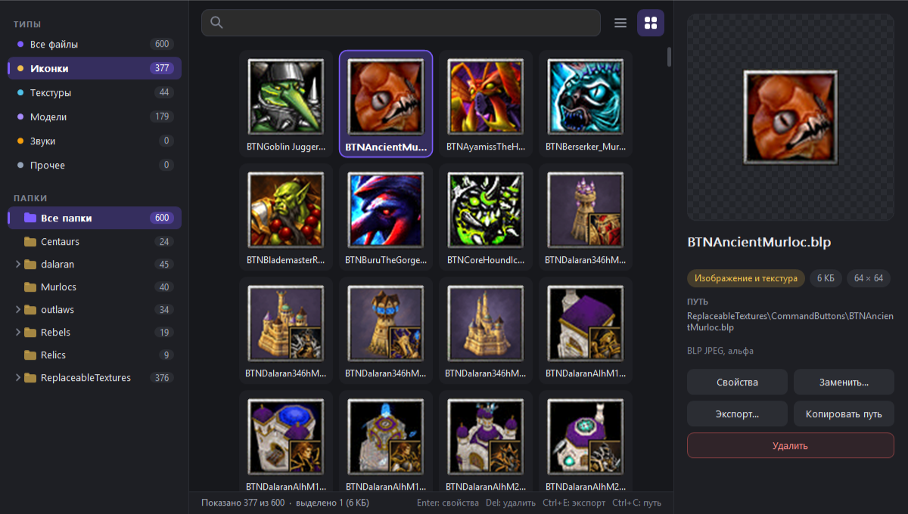
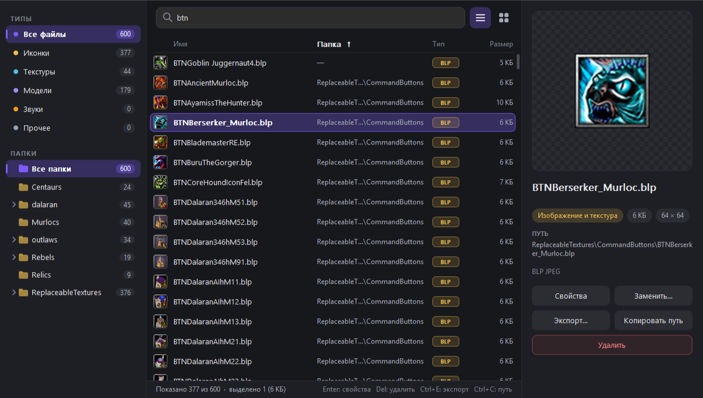

<div align="center">

# KFWE

Редактор Warcraft 3 нового поколения

[](../../releases/latest)
[](../../releases)
[](#установка)
[](https://discord.gg/2Chc8rbXXD)

**[Скачать](../../releases/latest)** · [Discord](https://discord.gg/2Chc8rbXXD)



</div>

## Установка

1. Скачайте `KFWE-Setup.exe` со страницы [Releases](../../releases/latest).
2. Запустите его. Папку с игрой установщик найдёт сам, если не найдёт, укажите её вручную.
3. Нажмите «Установить», потом «Запустить».

Если KFWE у вас уже стоит, тот же установщик просто обновит его, а настройки останутся прежними.

Если Windows ругается на неизвестное приложение, нажмите «Подробнее» и «Выполнить в любом случае». Можно обойтись и без установщика: скачайте `KFWE.zip` и распакуйте его в папку с игрой.

## Что нового по сравнению с PK

- **Скорость.** Ускорено почти всё: запуск редактора, сохранение и тест карты, редактор объектов, окна выбора. На больших картах разница особенно заметна.
- **Поиск** в окнах выбора модели, способности и других списках.
- **Новый менеджер импорта.** Папки, разбивка по типам, поиск, превью иконок и текстур, выделение рамкой, экспорт и удаление сразу нескольких файлов.
- **Тест за любого игрока,** а не только за красного.
- **KFMO.** Свой оптимизатор карт вместо w3x2lni: быстрее и не трогает тексты стандартных объектов.
- **Тёмное оформление** окна настроек и окна покраски текста.



## KFMO отдельно

KFMO можно скачать отдельно, это `KFMO.zip` в [Releases](../../releases/latest). Выбираете карту, отмечаете, что сжимать, и получаете облегчённую копию. Удобно перед выкладкой карты.

<details>
<summary><b>Сборка из исходников</b></summary>

<br>

```
kfmo/src      KFMO, консольная версия (её вызывает редактор)
kfmo/gui      KFMO с окном
kfwe/         изменённые файлы редактора, разложены как в его папке
installer/    установщик
```

**KFMO** собирается через [.NET 10 SDK](https://dotnet.microsoft.com/download):

```
dotnet publish kfmo/src -c Release -r win-x64 --self-contained true -p:PublishSingleFile=true -p:IncludeNativeLibrariesForSelfExtract=true -p:EnableCompressionInSingleFile=true -o out/kfmo
dotnet publish kfmo/gui -c Release -r win-x64 --self-contained true -p:PublishSingleFile=true -p:IncludeNativeLibrariesForSelfExtract=true -p:EnableCompressionInSingleFile=true -o out/kfmo-gui
```

**Плагины** это 32-битные DLL на C. Подойдёт любой компилятор под x86 Windows, например zig (`pip install ziglang`). Из папки `kfwe/plugin`:

```
python -m ziglang cc -target x86-windows-gnu -shared -O2 -s StormFastHeap/src/stormfastheap.c -luser32 -o StormFastHeap.dll
python -m ziglang cc -target x86-windows-gnu -shared -O2 -s ModelSearch/src/modelsearch.c -luser32 -lgdi32 -o ModelSearch.dll
python -m ziglang cc -target x86-windows-gnu -shared -O2 -s ImportPlus/src/importplus.c -luser32 -lgdi32 -lcomctl32 -lcomdlg32 -lshell32 -lole32 -lmsimg32 -lwindowscodecs -luuid -lgdiplus -o ImportPlus.dll
python -m ziglang cc -target x86-windows-gnu -shared -O2 -s warcraft3/kf_playas/kf_playas.c warcraft3/kf_playas/kf_playas.rc -o kf_playas.dll
```

YDColorizer собирается через MSBuild из .NET Framework: `MSBuild.exe YDColorizer.csproj -p:Configuration=Release -p:Platform=AnyCPU`.

**Установщик** собирается из готовой папки редактора:

```
python installer/make_payload.py "путь\к\KFWE" installer/kfwe.zip
dotnet build installer -c Release -p:Payload=kfwe.zip
```

</details>

## Благодарности

[YDWE](https://github.com/actboy168/YDWE), на котором всё построено, и YDWE PK, от которой отталкивается KFWE. [w3x2lni](https://github.com/sumneko/w3x2lni), [War3Net](https://github.com/Drake53/War3Net), LibDeflate.NET, LibJpeg.NET и pjass, на них работает KFMO.
